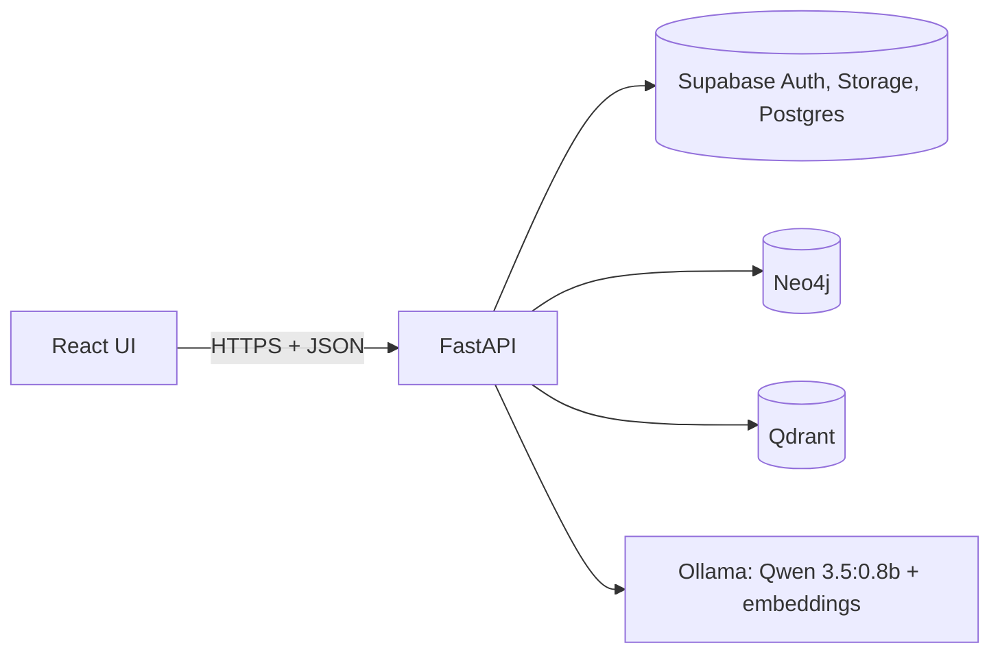
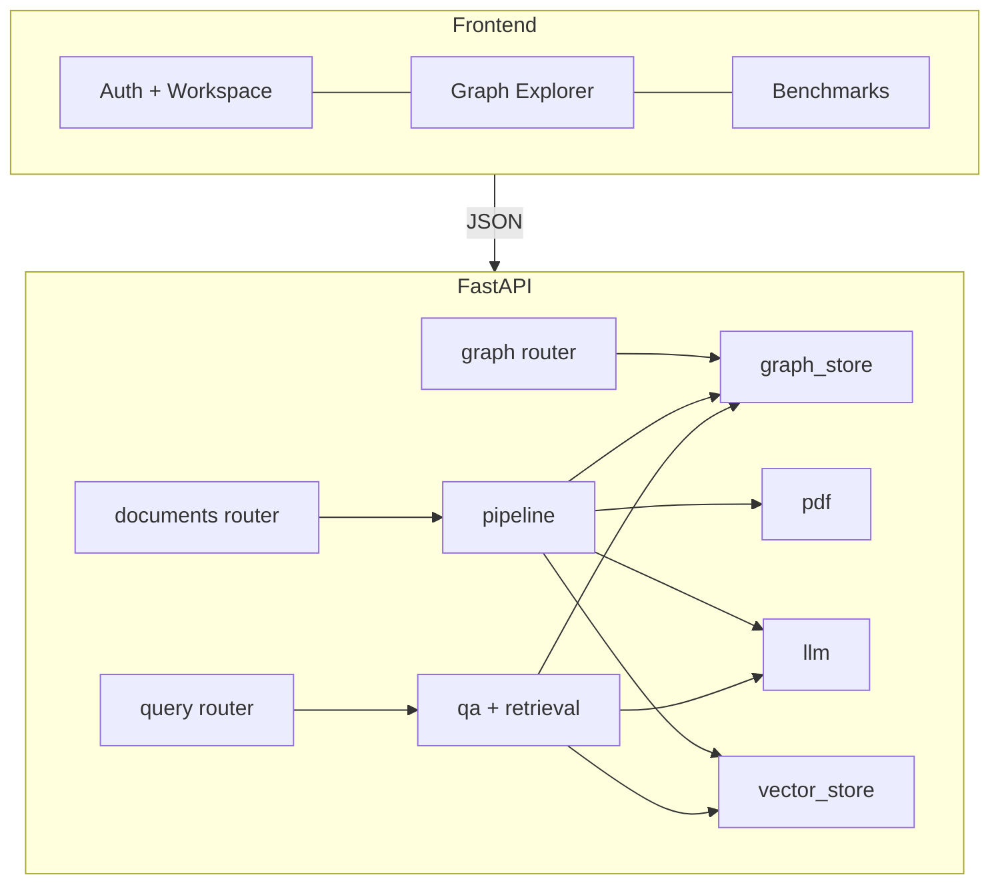

# Software Design Document: Medical GraphRAG

## 1. Introduction

### 1.1. Document Outline

This document follows the project design template. Section 1 introduces the system, Section 2 records assumptions, constraints and goals, Section 3 explains the architectural strategies, and Section 4 presents the system and subsystem architecture. Section 5 states the policies and tactics. Section 6 gives the detailed design of each component using the template attributes, and Sections 7 and 8 hold the glossary and bibliography.

### 1.2. Document Description

#### 1.2.1. Introduction

This project develops a GraphRAG pipeline that moves beyond basic vector-similarity search. The system ingests unstructured medical documents, extracts entities and relationships with an LLM, builds a persistent Knowledge Graph, and connects it to a vector database. This follows the GraphRAG approach of combining graph-derived structure with retrieval to support questions that require relationships across a corpus (Edge et al., 2024). Multi-hop graph traversal and hybrid search supply grounded context for complex reasoning queries and let users trace the relationships and sources behind each response.

The frontend displays answers generated by Qwen 3.5:0.8b together with source nodes and the graph path used. Basic authentication through Supabase Auth lets users upload PDFs that persist across sessions. The system also provides incremental re-indexing after a document is changed or removed, a side-by-side comparison of standard RAG and Knowledge Graph RAG on a separate benchmarks tab, and an interactive graph explorer with search, filtering, node expansion and source inspection.

#### 1.2.2. System Overview

The system has a React single-page application, a FastAPI backend, and four data and model services. The web interface uses React and the backend API uses FastAPI (FastAPI, n.d.; React, n.d.). Neo4j stores the Knowledge Graph, Qdrant stores chunk embeddings, Supabase stores PDFs and metadata, and Ollama serves Qwen for extraction and generation. Docker Compose runs the components in one reproducible environment (Docker, n.d.). The diagram below shows these links.

## 2. Design Considerations

### 2.1. Assumptions and Dependencies

Assumptions:

- Users supply PDFs with machine-readable text. Image-only documents are out of scope and are reported as failed.
- A base corpus of medical documents defines the allowed entity and relationship types. Users can add their own documents or remove them from their accounts.
- Users have a Google account, internet access, a desktop web browser, and a system able to run the graph visualization.
- Qwen 3.5:0.8b is the prototype model, and continued use depends on extraction and response quality during testing.
- Questions relate to information in the indexed documents.

Dependencies:

| Dependency | Purpose |
|---|---|
| Python, LangChain, Ollama | Pipeline and LLM integration |
| Neo4j | Knowledge Graph storage and Cypher traversal |
| Qdrant | Vector storage and similarity search |
| FastAPI, React | Backend API and web interface |
| Supabase Auth, Storage, Postgres | Sign-in, PDF storage, document metadata and state |
| Docker | Containerized deployment |

### 2.2. General Constraints

- **Schema fit.** Extraction must conform to an established graph schema, and identifiers must be consistent across the document store, Neo4j and Qdrant.
- **Traversal depth.** Graph traversal is limited to one or two hops initially (`MAX_HOPS`, default 2).
- **Access control.** Retrieval must use only documents available to the authenticated account, meaning the user's own documents and the global corpus.
- **Model capacity.** The server must host Qwen 3.5:0.8b for several simultaneous users, and data stores must hold the global corpus plus user documents.
- **Interface.** Browser access is through a desktop browser over HTTPS using JSON.
- **Security.** Secrets stay in backend environment variables, and Google passwords are never collected.
- **Input.** PDFs only, validated for format and size (default limit 25 MB).

### 2.3. Goals and Guidelines

1. **Grounded answers.** Every response cites document and page, shows the graph path, and never fabricates when context is missing.
2. **Verifiability.** Users can open the source PDF and inspect graph nodes.
3. **Consistency.** A document is "ready" only when graph and vector indexes both succeed.
4. **Isolation.** One account never sees another account's content.
5. **Minimalism.** A minimalist UI with labeled sections for upload, selection, query, answer, graph and benchmarks.
6. **Diagnosability.** Short messages for users, detailed logs for developers.

### 2.4. Development Methods

The team builds the prototype iteratively, starting with the ingestion pipeline, then retrieval and generation, then the UI tabs. Model suitability is judged during prototype testing, which is why the model name and embedding model are configuration values. The backend has 29 automated tests. They cover schema validation, normalization, PDF rejection, Cypher statement shape, and the full API path (upload, duplicate handling, retry, retrieval, isolation, deletion, graph explorer) using the real FastAPI app and an in-memory Qdrant with stand-ins for Supabase, Neo4j and Ollama. The frontend has component tests, and the benchmarks tab supports ongoing comparison of the two retrieval approaches.

## 3. Architectural Strategies

**Hybrid retrieval over a single store.** Vector search finds semantically similar passages, while graph traversal adds related entities that share no wording with the question, reflecting the graph-enhanced retrieval approach described by Edge et al. (2024). The standard RAG baseline reuses the same vector path, so the benchmark isolates the contribution of the graph. LangChain supports the orchestration of the pipeline (LangChain, n.d.). A pure vector pipeline was rejected because it cannot follow relationships across chunks.

**Dedicated graph and vector databases.** Graph traversal and similarity search are different workloads, so the design uses a separate engine for each. Neo4j provides Cypher for multi-hop traversal (Neo4j, n.d.), and Qdrant provides filtered similarity search with payload metadata (Qdrant, n.d.). A single database holding both was considered and rejected to keep each engine on the workload it handles best. Cross-store identifiers (document id, chunk id, entity id) keep the two consistent.

**Schema-constrained extraction.** The LLM is prompted with the allowed node and relationship types, and every output is validated before it reaches Neo4j. Qwen 3.5:0.8b is a very small model (Qwen Team, 2026), so its output can be noisy and validation is the main quality control. Unvalidated free-form extraction was rejected because it creates duplicate and inconsistent nodes.

**Local LLM through Ollama.** Documents stay on the deployment when Qwen runs locally, and there is no per-token cost. Ollama serves the model and its embeddings to the backend (Ollama, n.d.-a), and the Qwen documentation describes the model family (Qwen, n.d.). The trade-off is limited throughput, so ingestion runs as a background task and the UI polls for state. A hosted LLM API remains possible because the model is a configuration value.

**Managed identity and storage.** The team avoids building its own password system by delegating identity and storage. Supabase supplies Google sign-in, object storage and Postgres (Supabase, n.d.-b). The backend verifies every token and uses the service role key only on the server. Users therefore never create a separate password.

**Error handling and recovery.** Each pipeline stage is tracked. Any failure removes partial graph and vector data, marks the document failed with a readable message, and allows retry. Documents left in "processing" by a restart are marked failed at startup.

## 4. System Architecture

The system is divided into a presentation tier, an application tier and a data tier. The presentation tier holds the React application. The application tier holds the FastAPI routers and the pipeline services. The data tier holds Supabase, Neo4j, Qdrant and Ollama.

### 4.1. Subsystem Architecture

| Subsystem | Code | Responsibility |
|---|---|---|
| Identity and access | `auth.py`, `repo.py` | Token verification, account scoping, document metadata |
| Ingestion | `services/pdf.py`, `services/pipeline.py` | Validate, store, chunk, orchestrate stages, state transitions |
| Extraction | `services/llm.py`, `schema.py` | Qwen extraction, schema validation, normalization |
| Graph store | `services/graph_store.py` | Neo4j writes, deletes, traversal, explorer queries |
| Vector store | `services/vector_store.py` | Qdrant upsert, filtered search, chunk lookup |
| Retrieval and generation | `services/retrieval.py`, `services/qa.py` | Hybrid and standard retrieval, grounded answers |
| Web interface | `frontend/src` | Workspace, graph explorer, benchmarks |

The ingestion data flow follows Figure 1 of the requirements specification: upload, store, chunk with ids, extraction and embedding, write to Neo4j and Qdrant, then mark ready. The two branches of the figure run one after the other in the implementation, which gives the same result and simplifies cleanup on failure. The query flow embeds the question, retrieves from both stores, merges context, generates with Qwen, and returns the answer with citations and graph paths.

## 5. Policies and Tactics

- **Access policy.** All endpoints require a valid bearer token. Document ids from the client are intersected with the documents the account may read before any query runs. Qdrant filters and Cypher `scope` and `doc_id` predicates repeat this restriction.
- **Naming and identity.** Entity ids are a hash of scope, type and normalized name, which prevents duplicates within an account. Chunk ids are UUIDs shared by Neo4j and Qdrant.
- **Deletion policy.** Removing or replacing a document deletes its relationships, chunks and vectors, then deletes entities no longer mentioned by any chunk.
- **Answer policy.** No retrieved context yields an explicit "no usable context" response without calling the LLM. Partial support yields the evidence plus an insufficiency note.
- **Logging.** Users see brief stage and error text. The backend logs stack traces and stage names.
- **Secrets.** Service keys live in backend environment variables and are excluded from version control through `.gitignore`.
- **Testing.** `pytest` covers the backend and `vitest` covers the frontend components. The benchmarks tab provides manual quality comparison.
- **Coding conventions.** Whitelisted labels and relationship types are the only values interpolated into Cypher. All other values are parameters.

## 6. Detailed System Design

Section 6 applies the template attributes to the system components. Subsection 6.10 gives the detailed design of each subsystem.

### 6.1. Classification

| Component | Kind |
|---|---|
| Web interface | Package of React components |
| API routers | FastAPI modules |
| Ingestion pipeline | Service module with a background task entry point |
| Extraction and schema | Service module and pure validation module |
| Graph store, vector store | Data access modules |
| Retrieval and generation | Service modules |

### 6.2. Definition

Each component realizes a requirement group in the specification. The web interface implements Sections 3.1, 3.3, 3.9 and 3.10. The ingestion pipeline implements Sections 3.4, 3.5 and 3.8. Retrieval and generation implement Sections 3.6 and 3.7. Identity and access implement Sections 3.2 and 4.1.

### 6.3. Responsibilities

- The interface renders state and sends authenticated requests.
- Routers validate input and enforce authorization.
- The pipeline owns document state transitions and cleanup.
- The stores own persistence and scoped queries.
- Retrieval merges, deduplicates and attributes context. Generation grounds the answer and reports support level.

### 6.4. Constraints

- Upload must be a PDF with a `%PDF-` header and within the size limit.
- A document becomes `ready` only after both indexes succeed.
- Traversal depth is capped (default 2, hard cap 4).
- Retrieval uses only `ready` documents the account may read.
- Vector hits below `MIN_SCORE` (default 0.3) are discarded.
- Duplicate uploads (same SHA-256 per account) are rejected unless the user overrides.

### 6.5. Composition

The backend is composed of `config`, `stores`, `auth`, `repo`, `schema`, three routers, and six services. The frontend is composed of `App`, `Workspace`, `GraphExplorer`, `Benchmarks`, `Answer` and `GraphView`. Infrastructure is composed of Docker Compose services for Neo4j, Qdrant, Ollama, the model puller, backend and frontend.

### 6.6. Uses/Interactions

The routers call the pipeline and the retrieval services. The pipeline calls the PDF, LLM, graph and vector modules and updates state through `repo`. Retrieval calls the embedder, vector store and graph store. The frontend reaches the backend only through `/api` with a Supabase access token. Source PDFs open through short-lived signed URLs from Supabase Storage (Supabase, n.d.-c). This keeps the storage bucket private.

### 6.7. Resources

- Supabase Auth, Storage (private bucket) and Postgres tables `profiles` and `documents`.
- Neo4j database with constraints on entity, chunk and document ids.
- Qdrant collection `chunks` with cosine distance and keyword indexes on `doc_id` and `scope`.
- Ollama models for extraction and embedding. Ingestion is sequential per document, so CPU or GPU time on the model server is the limiting resource.
- Concurrency risk: two simultaneous uploads of the same file by one account could both pass the duplicate check before either row exists. This is accepted for the prototype and noted for future work, for example through a unique index on owner and hash.

Supabase holds identity, files and metadata for the application. The `documents` table records the state and stage of each upload, following the database guide (Supabase, n.d.-a). The `profiles` table holds custom usernames. The storage bucket stays private.

### 6.8. Processing

**Ingestion.** Validate upload, hash, check duplicates, store PDF, insert row as `processing`, then run the background task: download, extract text and chunks with page numbers, clear any previous index, extract and validate entities per chunk, write the graph, embed chunks, write vectors with entity ids, set `ready`. Any exception cleans up and sets `failed`.

**Query.** Embed the question, search Qdrant with document and scope filters, find seed entities from hit chunks and from entity names in the question, traverse up to `MAX_HOPS`, fetch chunks referenced by path edges, merge without duplicates, build a context of passages and relationship lines, generate a JSON answer with a support level, and return answer, sources, nodes, edges and paths.

**Standard RAG.** The same vector search and generation without the graph steps, used by the benchmarks tab.

### 6.9. Interface/Exports

| Method and path | Purpose |
|---|---|
| `GET /api/me`, `PUT /api/me/username` | Account and custom username |
| `GET /api/documents`, `POST /api/documents` | List, upload (`override` flag) |
| `POST /api/documents/{id}/retry`, `DELETE /api/documents/{id}` | Retry failed, remove and de-index |
| `GET /api/documents/{id}/url` | Signed URL to open the source PDF |
| `POST /api/query` | Answer with sources and graph path (`graph` or `standard`) |
| `POST /api/benchmark` | Both pipelines on one question |
| `GET /api/graph`, `/api/graph/expand/{id}`, `/api/graph/node/{id}`, `/api/graph/types` | Explorer data |

Query responses contain `answer`, `support` (`full`, `partial`, `none`), `no_context`, `sources` (document, page, snippet, origin), `graph` (nodes, edges, paths) and `latency_ms`.

### 6.10. Detailed Subsystem Design

**Identity and access.** Classification: module. Token verification calls Supabase with the bearer token and rejects missing or invalid credentials with HTTP 401. Ownership checks protect mutation endpoints so a user cannot delete or retry another user's document or the global corpus.

**Ingestion.** Classification: service. Stages are recorded in `documents.stage` for the UI. Empty, image-only or unreadable PDFs raise an ingest error with a user-readable message. Failed jobs can be retried after the cause is corrected.

**Extraction.** Classification: service plus pure module. The prompt lists the allowed types and requests JSON only. Validation canonicalizes type case, rejects unknown types, drops relations whose endpoints are missing, removes self-loops and duplicates, and counts rejections. Entities merge on normalized name within an account scope.

**Graph store.** Classification: data access module. Nodes are `Document`, `Chunk` and `Entity`. Entity-to-entity relationships carry `doc_id` and `chunk_id`, so every edge is traceable to a page. Traversal returns node and relationship lists per path for display and highlighting.

**Vector store.** Classification: data access module. Each point stores chunk text, document id and name, page, scope, owner and the entity ids found in that chunk, which links the vector to the graph.

**Retrieval and generation.** Classification: service. Graph-derived chunks not already found by vector search are added with origin `graph`. When the model reports partial support, or its output cannot be parsed, the answer is flagged as insufficient. This conservative default favors transparency over confidence.

**Web interface.** Classification: React package. The workspace polls document state while any document is processing. The explorer supports search, type filters, node expansion, source inspection, PDF opening and path highlighting from the last answer. The benchmarks tab runs both pipelines and shows answers, sources and latency side by side.

## 7. Glossary

| Term | Definition |
|---|---|
| API | Application Programming Interface between the web interface and backend |
| Chunk | Bounded passage of extracted text stored with document id and page |
| Cypher | Query language used to traverse the Knowledge Graph in Neo4j |
| Entity | Distinct item in source text, represented as a graph node |
| GraphRAG | Retrieval Augmented Generation using a Knowledge Graph and vector search |
| Hybrid retrieval | Combination of semantic vector search and graph traversal |
| Knowledge Graph (KG) | Persistent collection of entities and relationships as nodes and edges |
| LLM | Large Language Model used for extraction and response generation |
| Multi-hop traversal | Following connected relationships across a series of hops |
| Standard RAG | Retrieval Augmented Generation using vector search only |
| UI | User Interface |

## 8. Bibliography

Docker. (n.d.). *Docker documentation*. https://docs.docker.com/

Edge, D., Trinh, H., Cheng, N., Bradley, J., Chao, A., Mody, A., Truitt, S., Metropolitansky, D., Ness, R. O., & Larson, J. (2024). *From local to global: A graph RAG approach to query-focused summarization*. arXiv. https://arxiv.org/abs/2404.16130

FastAPI. (n.d.). *FastAPI references*. https://fastapi.tiangolo.com/reference/

LangChain. (n.d.). *LangChain documentation*. https://docs.langchain.com/

Neo4j. (n.d.). *Neo4j documentation*. https://neo4j.com/docs/

Ollama. (n.d.). *Ollama documentation*. https://docs.ollama.com/

Qdrant. (n.d.). *Qdrant documentation*. https://qdrant.tech/documentation/

Qwen. (n.d.). *Qwen documentation*. https://qwen.readthedocs.io/en/latest/

Qwen Team. (2026). *Qwen3.5: Towards native multimodal agents*. https://qwen.ai/blog?id=qwen3.5

React. (n.d.). *React references*. https://react.dev/reference/react

Supabase. (n.d.-a). *Database*. https://supabase.com/docs/guides/database/overview

Supabase. (n.d.-b). *Sign in with Google*. https://supabase.com/docs/guides/auth/social-login/auth-google

Supabase. (n.d.-c). *Storage buckets*. https://supabase.com/docs/guides/storage/buckets/fundamentals
